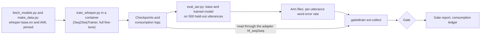

# gatedtrain recipe: Whisper base.en SFT on AMI

This recipe teaches a small speech recognizer to transcribe meeting speech, and lets
[gatedtrain](https://github.com/gatedtrain/gatedtrain) decide whether the fine-tuned model really is better than the
one it started from. The Hugging Face transformers `Seq2SeqTrainer` fine-tunes all parameters of OpenAI Whisper base.en
on AMI Meeting Corpus speech (individual headset microphones). gatedtrain then gates the result against the base model
on the per-utterance word error rate of 500 held-out AMI test utterances, by a rule registered before training.

A recipe is a ready-made external run for gatedtrain: the training code with its locked environment, plus an
*adapter*, the small plugin through which gatedtrain reads the run's outputs. gatedtrain does not start the training;
you run it.

This is a prototype: the result below is one registered run, not a benchmark claim.

## How it works



`gatedtrain ext-launch` checks the run request and prints the container command; you run it. The steps, flags and
arm files are explained in gatedtrain's [External runs](https://gatedtrain.github.io/gatedtrain/external-runs/) guide.

## Results

One registered run, 300 training steps:

| | Word error rate, 500 held-out utterances (lower is better) |
|---|---|
| Base (Whisper base.en) | 0.153 |
| Trained (cut 300) | 0.108 |
| Gate | **PASS** under the original registration; **INCONCLUSIVE (post_hoc)** under the registration amended for the renames: delta 0.0455, 95% cluster-bootstrap interval [0.0348, 0.0557], p <= 9.6e-05 |

The original gate was collected on 2026-11-13. The amendment for the framework's renames changes the evaluator after
the result was seen, so gatedtrain reports the same numbers as INCONCLUSIVE, not PASS. `RESULT.md` has the full record of both, with the power, overlap with training and the amendments.

`results/2026-11-13/` holds the gate files and CPU evidence; `RESULT.md` has the gate's verdict and its amendments
for the framework's renames (the run's outputs are not published in this repository).
The files under results/2026-11-13/ are redacted copies (host paths replaced with `<data-root>/...`, internal process
notes reworded) of `gate/EVAL-PLAN.md`, `gate/registration.yaml` and `gate/spec.yaml`; the gate-time originals are not
published.

`trainer.yaml` and `sanity-evidence/` are unchanged; `spec.yaml` still pins the original `registration.yaml` hash.
The runtime scripts were unchanged by this redaction; `RESULT.md` lists their later re-pins.

## Setup

```bash
pip install "gatedtrain @ git+https://github.com/gatedtrain/gatedtrain@v0.3.0"   # the framework, at the release this recipe was tested with
pip install -e .                                  # the adapter, into the environment that runs gatedtrain
cd runtime && uv sync --frozen                    # the training and evaluation environment
.venv/bin/python fetch_models.py                  # whisper-base.en and the AMI shards at pinned revisions (network)
.venv/bin/python make_data.py                     # data/ and items/ (rewrites items/items.jsonl; its SHA-256 is 94d0bea4...d29fc)
```

`make_data.py` writes the audio and `data/train.jsonl` and rewrites the three committed files (`data/data_meta.json`,
`items/items.jsonl`, `items/item_set_meta.json`). It refuses to start only when generated content is present
(`data/audio`, `data/train.jsonl`, `items/audio`; delete them to rebuild), and after writing it checks the three
committed files byte for byte against their bytes before the run: it prints `reproduced the committed ... byte for
byte`, or exits non-zero naming the files that differ (then the registered item-set hash no longer holds).

`fetch_models.py --verify` re-hashes every downloaded file against `models/MODELS.json` and `data-source/DATA.json`.
Weights, audio and the downloaded parquet shards are not committed (`.gitignore`). The adapter finds the runtime at
`runtime/` of this checkout (or `GATEDTRAIN_RECIPE_WHISPER_SFT_AMI_RUNTIME`); runs go under the host's gatedtrain
output root (`<output_root>/whisper-sft-ami`). It locates `runtime/` from its own source tree, so an editable install
(`pip install -e .`) of a checkout works as is; a non-editable install (a wheel) has no `runtime/` next to the package
and needs `GATEDTRAIN_RECIPE_WHISPER_SFT_AMI_RUNTIME` set to the checkout's `runtime/` directory. `runtime/README.md` has the commands, mounts, profiles and the decisions behind the
metric. Checkpoints are loaded from safetensors only (`from_pretrained` of plain directories; no pickle weights are
downloaded or written).

## Layout

| Path | What |
|---|---|
| `src/gatedtrain_recipe_whisper_sft_ami/` | the gatedtrain adapter `hf_seq2seq` (`adapter.py`) and its registry rows (`rows.py`), registered through the `gatedtrain.adapters` entry point |
| `runtime/` | what runs in the container: `train_whisper.py`, `eval_asr.py`, the host steps `fetch_models.py` and `make_data.py`, the pin manifests (`models/MODELS.json`, `data-source/DATA.json`), the registered item set (`items/items.jsonl`, `items/item_set_meta.json`; audio not committed), `data/data_meta.json`, and its own `pyproject.toml` and `uv.lock` |
| `tests/` | the adapter's tests on fixture runs (no model or audio needed) and gatedtrain's conformance check |
| `results/2026-11-13/` | the gate drafts (`gate/`) and the CPU sanity and power-pilot evidence (`sanity-evidence/`) |

## Tests

```bash
python -m unittest discover -s tests -t tests
```

Code comments, tests, `RESULT.md` and the gate files under `results/` cite records of the framework's development:
the maintainers' decision record ("Area 4 decisions"), the framework's review rounds ("review 9 L1", "review 11 L1")
and ids of its internal issue lists (`G-21`). Those records are not published.

## Data and licenses

| Component | Pin | License | Attribution and use here |
|---|---|---|---|
| AMI Meeting Corpus, IHM (Kaldi s5 segmentation and text), via the Hugging Face mirror `edinburghcstr/ami`, config `ihm` | revision `46f28f2503e2ec48f8867a84eef356c70476beab`; files and SHA-256 in `runtime/data-source/DATA.json` | CC BY 4.0 (https://creativecommons.org/licenses/by/4.0/) | AMI Meeting Corpus, https://groups.inf.ed.ac.uk/ami/corpus/. **Redistributed:** `runtime/items/items.jsonl` holds 500 test-split transcripts (meetings EN2002, ES2004, IS1009, TS3003) with their AMI speaker and meeting ids; `tests/fixtures/whisper/*.sample.jsonl` hold 3 + 3 rows. Changes: utterances selected, a normalized reference added. Audio is not committed (rebuilt by `make_data.py`). See `THIRD_PARTY_NOTICES.md`. |
| Whisper base.en, `openai/whisper-base.en` | revision `911407f4214e0e1d82085af863093ec0b66f9cd6`; files and SHA-256 in `runtime/models/MODELS.json` | Apache-2.0 (the model card's `license` at that revision) | Radford et al., "Robust Speech Recognition via Large-Scale Weak Supervision" (2022). Downloaded, not redistributed; fine-tuned weights are derived from it. |
| transformers, accelerate, torch, tokenizers and the other locked packages | `runtime/uv.lock` | their own licenses | Installed by `uv sync --frozen`, not redistributed. |
| Container base image | `docker.io/nvidia/cuda:13.0.3-devel-ubuntu24.04@sha256:b7ae301dea2c162444795462ce17a05f6a516e5a75944b57af5b88540a1a2266` | the license terms on the image's Docker Hub page (`nvidia/cuda`) and those of its packages | Pulled, not redistributed. |

## License

Apache License 2.0, see `LICENSE` and `NOTICE` (the recipe's code and documents). Third-party data keeps its own
license: the AMI transcripts redistributed here are CC BY 4.0, with attribution and changes in the table above and in
`THIRD_PARTY_NOTICES.md`.

Names of third-party projects and products are trademarks of their owners; this project is not affiliated with or
endorsed by them.
